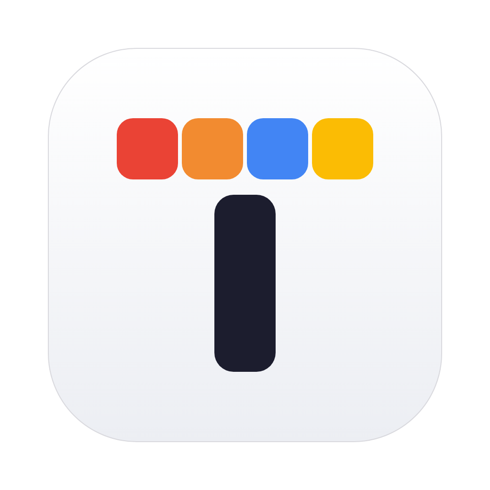

<p align="center"></p>

# Tuttibox

A lightweight desktop app for Windows and macOS that brings your web apps into one window.

## Features

- Switch services from the sidebar on the left; the selected service is shown on the right
- Add services from the "+" button at the bottom left (the same service can be added more than once, e.g. for multiple accounts)
- Reorder sidebar icons by drag and drop
- Context menu on sidebar icons: Reload / Edit / Remove
- Edit window for the name, unread badge on/off and custom JavaScript
- Separate, persistent login session for each service (`persist:<id>` partition)
- Unread badges in the sidebar, plus the total on the Dock (macOS) or as a taskbar overlay icon (Windows)
- Desktop notifications from services are suppressed; unread counts are shown only as badges
- Export / import the added apps, their settings and their order from the File menu (login sessions are not included)
- Settings window (gear button under the add button, or File > Settings…) with a "Launch at login" toggle (macOS / Windows)
- Automatic updates from GitHub Releases (macOS / Windows), plus File > Check for Updates…

## Supported apps

Tuttibox was built for personal use, so only a small number of apps are supported. If you use Tuttibox and would like another app to be added, please [open an issue](https://github.com/t-hamano/tuttibox/issues/new) with your request.

| App | Unread badge |
|---|---|
| Gmail | Yes |
| Chatwork | Yes |
| Slack | Yes (mentions and DMs only) |
| Google Calendar | No |
| Google Keep | No |

Apps are defined in `src/main/services.ts`.

## Development

```bash
npm install
npm start
```

## Building installers

```bash
npm run dist:mac
```

```bash
npm run dist:win
```

Output goes to `release/`. Build each platform on that platform.

## Releases and automatic updates

1. Bump `version` in `package.json` (for example `0.2.0`) and commit it.
2. Push a matching tag: `git tag v0.2.0 && git push origin v0.2.0`.
3. GitHub Actions (`.github/workflows/release.yml`) builds macOS and Windows and uploads them to a **draft** release.
4. Check the draft and publish it. Installed apps only see published releases.

- macOS: signed with Developer ID Application and notarized. Universal (Intel / Apple Silicon). The `.zip` is what the updater downloads; the `.dmg` is for first installs.
- Windows: not signed (x64 / arm64). SmartScreen warns on the first install; updates install without a prompt.

The app checks for updates 10 seconds after launch (and from File > Check for Updates…), downloads in the background and asks to restart. If the user picks "Later", the update is installed on the next quit. Updates need the repository to be public, since the app reads GitHub Releases without a token. Development builds (`npm start`) never check.

Required repository secrets:

| Secret | Value |
|---|---|
| `APPLE_CERTIFICATE` | Developer ID Application certificate (.p12), base64 encoded |
| `APPLE_CERTIFICATE_PASSWORD` | Password of the .p12 |
| `APPLE_ID` | Apple ID email address |
| `APPLE_PASSWORD` | App-specific password for the Apple ID |
| `APPLE_TEAM_ID` | Team ID |

To make a signed build on a local Mac with the certificate in the keychain:

```bash
APPLE_ID=... APPLE_APP_SPECIFIC_PASSWORD=... APPLE_TEAM_ID=... npm run dist:mac
```

## App icon

The source is `build/icon.svg` (macOS, with the standard padding) and `build/icon-win.svg` (Windows, full bleed). `build/icon.png` and `build/icon-win.png` are 1024px exports used by electron-builder.

## Custom JavaScript

Right-click a sidebar icon and choose "Edit…".

The JavaScript runs on every page load. Saving a change reloads the page.

Settings are stored in `settings.json` (macOS: `~/Library/Application Support/Tuttibox/`, Windows: `%APPDATA%\Tuttibox\`).

## Unread badges

The unread count is read from a `(number)` in the page title. Apps that do not show an unread count in their title have no badge (see [Supported apps](#supported-apps)).

## Project structure

```
src/
  main/
    main.ts       Window and view management, adding/removing/reordering services, badges, menus
    services.ts   Service types that can be added (URL, how to read the unread count)
    settings.ts   Persists the service list, window position, etc.
    transfer.ts   Reads and writes the export file for File > Import / Export Settings
    updater.ts    Automatic updates from GitHub Releases
  preload/
    sidebar.ts    API for the sidebar
    service.ts    Suppresses web notifications from services
    edit.ts       API for the edit window
  renderer/
    sidebar.*     Sidebar UI
    empty.*       Shown when no services have been added
    edit.*        Service edit window
```
